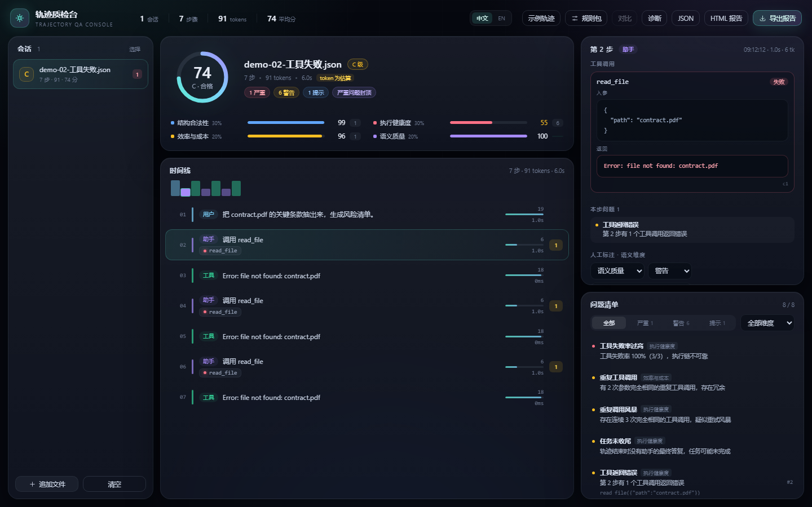
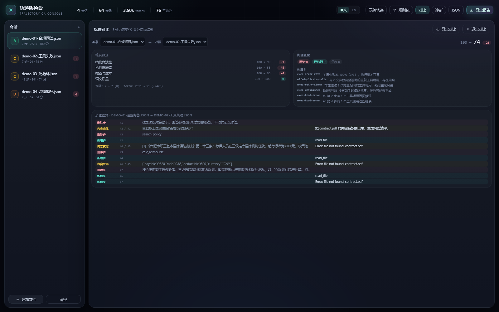
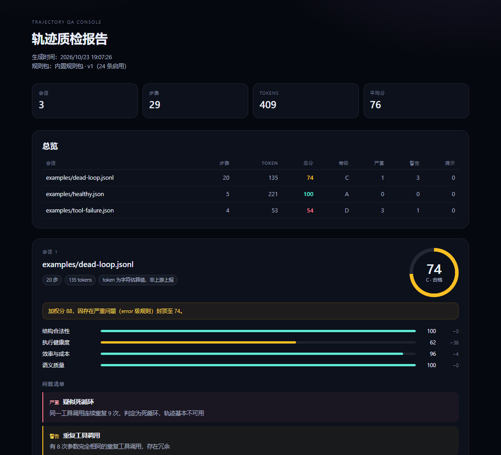
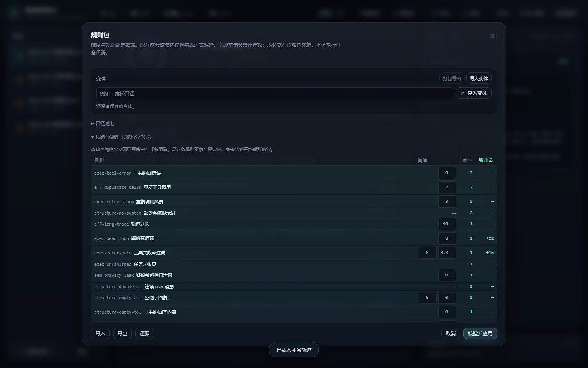
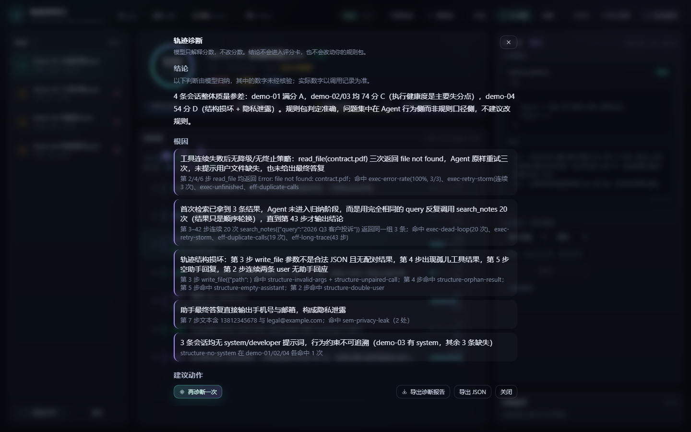

# Trajectory QA Console

[](https://github.com/GaussAA/trajectory-qa-console/actions/workflows/ci.yml)
[](https://github.com/GaussAA/trajectory-qa-console/releases)


[](LICENSE)

**智能体轨迹数据的四维质检台**：拖入 Agent 轨迹（OpenAI messages / tool_calls 格式），本地完成解析、评分与问题定位——零后端、零上传、双击即用。

A single-file, offline QA console for agent trajectory data. Drop a trace, get a four-axis checkup.



## 它解决什么问题

Agent 上线前后的轨迹（system / user / assistant / tool 结果交错）常藏着结构缺陷与执行病灶：
工具调用没有配对结果、参数是非法 JSON、连续 9 次重复调用、失败率超三成……
人工翻日志既慢又容易漏。本工具把这类**可规则判定**的问题自动化，逐条定位到具体步骤并给出可执行建议。

## 功能

- **四维评分**：结构合法性 / 执行健康度 / 效率与成本 / 语义质量；严重问题触发等级封顶，不让一条致命缺陷被加权平均稀释。
- **沙箱规则 DSL**：24 条内置规则都是数据（`scope + expr`），表达式经编译期校验 + 白名单解释器求值（无 `eval`）；字段契约带最近匹配建议。中英双语规则包（`packs/builtin-en.json`）。
- **试跑与调参**：在抽屉里改阈值，命中数与「禁用后能涨几分」即时重算；满意后存成**命名变体**，一键切回。
- **轨迹对比**：按结构（角色 + 工具序列）LCS 对齐、按内容指纹判变——改 prompt 后「同一回合换了说法」显示为内容变化，而非全删全增。
- **报告三形态**：Markdown（贴 PR / 周报）、JSON（键名稳定，给 CI）、单文件 HTML（双击即看、零脚本、可打印为 PDF）。

<table>
  <tr>
    <td width="50%"></td>
    <td width="50%"></td>
  </tr>
  <tr>
    <td align="center">轨迹对比 · 结构对齐 + 内容判变</td>
    <td align="center">单文件 HTML 报告 · 打印即 PDF</td>
  </tr>
</table>

- **双语界面**：中文 / EN 一键切换，`<html lang>` 同步、持久化；报告跟随界面语言。
- **命令行**：整目录批量、`--fail-below` 质量门禁、`--semantic` 可选 LLM 语义复核（密钥只从环境变量读取、失败自动降级）。产物为自包含单文件，拷到任何 Node 22 机器即可运行。
- **智能体诊断（可选）**：把分数交给模型解释——根因、可执行动作、规则包提案。它**只解释分数，不改分数**；提案要你点了才算数，且采纳前会自动把旧口径存成变体。


<p align="center"><sub>试跑与调参 · 改阈值即刻重算命中；存成命名变体一键切回</sub></p>


<p align="center"><sub>AI 诊断 · 模型解释分数：每条根因都带步号与规则 id，数字来自工具调用而非模型口算</sub></p>

## 快速开始

```bash
pnpm install
pnpm dev              # 开发
pnpm build            # 产出 dist/index.html（单文件）+ dist-cli/qa.mjs（CLI）
pnpm verify           # typecheck + lint + coverage + 文案扫描 + 构建 + 产物契约 + CLI 冒烟
```

界面：打开 `dist/index.html`，拖入轨迹文件（`.json` / `.jsonl`），或点「示例轨迹」。

**支持的输入**：OpenAI Chat Completions 消息（数组或 `{messages:[…]}` 等常见容器）、JSONL、
OpenAI Responses 条目（`function_call` / `function_call_output`）、Anthropic 内容块
（`tool_use` / `tool_result`，并行结果会拆成独立步骤）。没有助手或工具步骤的会话不会被评分，
而是作为「被跳过」报告，不会拿到虚高分。也能读 ShareGPT（`conversations`）、LangChain
（`model_dump` / `messages_to_dict` / 构造器形式）和 SWE-agent 的 `history`。OpenHands 事件等其它格式
不支持，会被拒绝而不是打分，请先转成上面的形态，详见 [CONTEXT.md](CONTEXT.md) 的「输入格式」。
键盘：`↑` / `↓`（或 `j` / `k`）逐步查看轨迹。

界面随窗口自适应：**宽度**决定几栏（1280 以上三栏，1024–1279 左栏收成 56px 图标条，
1024 以下单栏堆叠、页面纵向滚动），**高度**决定每栏多紧凑（矮屏时分数区自动压缩，
把高度让给时间线）。左栏可手动折叠成图标条，选择会被记住。
调试深链：`#demo:N` 载入示例、`#stress:N` 生成 N 步合成轨迹、`?drawer=1` / `?diag=1` / `?compare`；
`?agent=http://127.0.0.1:7788` 启用「AI 诊断」按钮（需先起 `serve`，有 token 时再加 `&agentToken=`）。

命令行：

```bash
node dist-cli/qa.mjs examples                          # 列表 + 结论
node dist-cli/qa.mjs traces --fail-below 80            # 门禁（不通过退出码 1）
node dist-cli/qa.mjs a.json b.json --compare --out cmp # 对比报告
node dist-cli/qa.mjs traces --format html --out out    # HTML 报告
node dist-cli/qa.mjs traces --semantic-dry-run         # 语义复核：只看提示词，不调用模型
```

语义复核需环境变量：`TQA_LLM_URL`、`TQA_LLM_MODEL`、`TQA_LLM_API_KEY`（只从环境读取，不接受命令行参数）。
`TQA_LLM_URL` 也可只写 base（`https://host/v1`，会自动补 `/chat/completions`）；自带路径的本地代理地址原样使用。
推理型模型响应慢时，用 `--llm-timeout <秒>`（5–600）调整单次请求的超时；默认语义复核 60 秒、智能体诊断 90 秒，`qa serve` 同样适用。智能体整轮仍受 180 秒总时限约束。

## 智能体诊断（可选）

模型能说清「这条为什么只有 54 分」和「该改哪条规则」——这两件事规则做不到。它调用本工具的
12 个只读/纯计算工具取数，所以结论里的每个数字都能追到一次调用，而不是模型自己算的。

```bash
# 命令行：诊断并产出 agent.md / agent.json
node dist-cli/qa.mjs traces --agent --out qa-out
node dist-cli/qa.mjs traces --agent-dry-run          # 只看提示词与工具清单，零成本
node dist-cli/qa.mjs traces --agent --agent-task "只看工具报错后有没有重试"

# 界面：起本地服务，按它提示的地址打开即多出「诊断」按钮
node dist-cli/qa.mjs serve                           # 默认 127.0.0.1:7788
```

- **密钥不进页面**：界面经本地服务调模型，key 只在服务进程里。服务只监听 `127.0.0.1`，
  CORS 只放行本机页面；公用机器可加 `--token <secret>`（界面用 `?agentToken=` 传）。
- **提案不会自动生效**：命令行写成 `proposal.pack.json`（可直接 `--pack` 试用），
  界面点「应用到工作区」也会先把当前规则包存成变体，随时切回。
- **报告单独成篇**：`agent.md` / `agent.json` 与 `report.*` 并列，不混写——模型的话会漂移，
  混进去以后就分不清哪句是规则说的。
- 不开就是完全离线：不点「诊断」不产生任何网络请求。

## 工程

- **815 项测试**，覆盖率 96.0% 行 / 88.3% 分支 / 95.5% 函数；`pnpm verify` 九道关全绿是合并的唯一标准。
- 分层：`core`（解析 / 规则 / 评分 / 对比 / 语义 / 智能体）/ `core/llm`（超时、重试、响应解析共用一份）/ `app`（状态机 / 持久化 / 遥测 / 分析端口）/ `ui` / `lib` / `cli`，接口小而行为厚。
- 行为快照：4 条示例轨迹的分数与问题清单逐字段锁定（golden master）；600+ 例解析 fuzz；性能预算测试（10k 步 < 3s）。
- 领域词汇、不变量与模块地图见 [CONTEXT.md](CONTEXT.md)；19 份 ADR 记录关键取舍（[docs/adr](docs/adr)）。

## License

[MIT](LICENSE)
